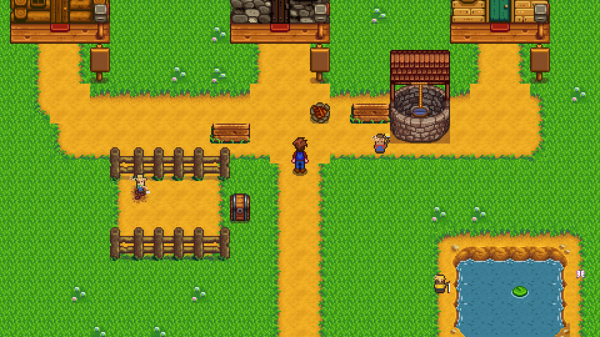

# Brawnie Hollow

**Version 0.1.0 — first playable village prototype.** Author: **Rachman Nurhakim**.

Meet Bram, an industrious rival farmer, Mira, the keeper of the well, and Pip, a hopeful fisher. A separate, small settlement uses vanilla Stardew scenery with three cottages, a twelve-plot field, a well, pond, and evening hearth.



## Verification

Release build is clean. The final checks passed: 36 simulation/policy assertions, 13 installed-assembly smoke checks, and 21 actual isolated-game runtime assertions with no SMAPI errors. See [verification notes and limitations](docs/verification.md). The full-map `docs/village-preview.png` is a static art preview; the screenshot above is from the running game.

## Install

Requires Stardew Valley 1.6 and SMAPI 4.1 or later. Extract `BrawnieHollow 0.1.0.zip` into your game's `Mods` directory. The resulting folder must contain `manifest.json`, `BrawnieHollow.dll`, and `assets/`. Start through SMAPI. No Content Patcher pack or ValleyExchange installation is needed; no gameplay downloads are performed.

**Single-player only.** Multiplayer and split-screen are deliberately disabled in this prototype. Keep a backup of your save before trying any new mod.

## Visit, return, and talk

- Press **F8** during ordinary gameplay to visit. Press it again to return to your original location and tile.
- Alternatively use the SMAPI console commands **`bh_visit`**, **`bh_return`**, and **`bh_status`**.
- The sign at the village's southern path is another return interaction: stand nearby and use your normal action button.
- Stand within two tiles of a resident and use the action button to talk.
- `config.json` appears after launch. Change `VisitKey` if F8 conflicts with another mod. Residents have no floating name labels; their names remain in dialogue. Older `ShowResidentNames` config entries are ignored.

There is **no bus-stop sign and no entrance/world-map edit** in this release. The shortcut and console commands are the actual access methods. Visiting is blocked during menus, events, minigames, saving, and warps.

## What is simulated

Bram physically walks between jobs and plays two-frame tool/work animations before applying each change. The first visit on a new settlement can show tilling, sowing, and watering (visit promptly: offscreen work may already have completed some jobs); actual vanilla `HoeDirt` and `Crop` instances visualize the persisted plot state. Dedicated hoe/sowing frames are included. Watering uses the field-hand work frames; harvest uses the scythe frames. Days of watered growth are required before harvesting: spring parsnips (4 days), summer radishes (6), fall bok choy (4). Winter clears seasonal crops and pauses planting. Bram's harvest count is real saved production, not decorative dialogue.

Work continues offscreen while unpaused gameplay advances. At 18:00 remaining work is finished and residents gather at the hearth. Before overnight, unseen work is completed; watered crops advance once when the next day starts. Catch-up iterates missed days, including season changes. Repeated day-start calls do not grow crops twice. Menus, events, and saving freeze the live work loop.

Only the pure settlement state is stored, using SMAPI's save-specific data at the `Saving` event. Graphics/NPCs are rebuilt from this state. The transient location is **not registered in `Game1.locations`** and residents are not added to the vanilla social/schedule system. Leaving the village does not change the player's farm. Before sleep/save the player is returned, and pending village warps are cancelled. Dropped items are moved to the town Lost and Found when leaving, preserving their stack and custom data even if inventory is full. Returning to title clears runtime objects; switching saves loads that save's own settlement. Malformed or excessively old settlement data disables simulation writes rather than overwriting the existing data.

## Deliberate limits

- This is **not** the full long-term competition system: no prizes, shipping economy, festivals, friendship, marriage, quests, or player-versus-Bram score comparison yet.
- Mira and Pip stroll/work and have basic dialogue, but do not produce livestock goods/fish. Houses are decorative exteriors without interiors. The village art stays green in winter.
- The rival's field is display-only; vanilla tool and action harvesting are suppressed inside the hollow, including held input. Explicit resident dialogue and the return sign still work. Crops are projected from saved simulation state rather than trusted to vanilla overnight processing. Harvests increment Bram's tally, not player inventory.
- Residents use real NPC sprite objects with custom movement/rendering, but are intentionally not normal social-list/schedule NPCs and have no physical collision. Routes are simple, authored axis-aligned paths, not general pathfinding.
- Save-anywhere mods and unusual warp/event-overhaul combinations need in-game compatibility testing. Prefer normal overnight saves and leave with F8 before saving. This version does not claim broad compatibility validation.

## Build and test

Install .NET SDK 8, with Stardew Valley and SMAPI installed locally. The mod targets `net6.0`, matching the game. Edit `GamePath` in the project or override it:

```sh
dotnet run --project tests/Tests.csproj
dotnet build BrawnieHollow/BrawnieHollow.csproj -c Release -p:GamePath="F:/Steam/steamapps/common/Stardew Valley" -p:EnableModDeploy=false
```

Build output: `BrawnieHollow/bin/Release/net6.0/BrawnieHollow.dll` and `BrawnieHollow 0.1.0.zip`. Automatic live-game deployment is disabled. The console assertion runner targets .NET 8 and links only the pure simulation source; it needs no game runtime, test framework download, or graphics context. Red-cycle evidence and the final green output are under `tests/*.log` in the local workspace (ignored by Git).

Asset validation (development-only Pillow dependency):

```sh
python tests/test_assets.py
python tests/test_package.py
dotnet run --project smoke/Smoke.csproj
```

The assembly smoke runner loads the real built DLL against the installed game/SMAPI assemblies, constructs the mod entry, and roundtrips state with the game's Newtonsoft serializer. It is **not** a graphical gameplay test. `docs/village-preview.png` is a rendered art preview, not an in-game screenshot.

The map uses vanilla Stardew terrain, cabin, well, and craftable tilesheets loaded from the player's installed game. No vanilla texture sheets are redistributed. Players need no Python. Run `python tools/make_assets.py` to regenerate the map layout; the three user-owned Brawnie sprites are already included and are not modified by that command. `tools/render_preview.py --textures PATH_TO_PRIVATE_TEXTURE_EXPORTS` renders a development preview using locally exported game textures; those exports must stay outside the repository.

## Credits

Author: **Rachman Nurhakim**. Brawnie characters adapted from the author's own worker sprite art, with dedicated hoe/sowing frames. Scenery references vanilla game textures at runtime. Stardew Valley and its art belong to ConcernedApe. SMAPI and the mod build tooling belong to their respective authors.
